# AI Infra Guide：环境配置与 Git 工程管理

> 学习笔记 · Python / uv / PyTorch / CUDA / Git
>
> 目标：从零建立独立、可复现、可版本控制的 AI Infra 开发环境。本文适用于 macOS 本地开发和 Linux GPU 服务器；不包含特定推理框架的安装排错过程。

## 1. 整体工程架构

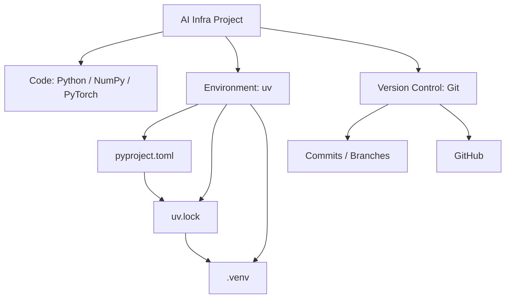

环境管理解决「代码如何运行」，版本控制解决「代码如何演进」。两者相互配合，但 Git 提交不会自动安装 Python 依赖，uv 同步也不会自动提交代码。

## 2. 使用 uv 初始化项目

检查工具：

```bash
uv --version
git --version
```

创建项目（Python 3.12 是本文选用的示例版本，并非所有项目必须使用的版本）：

```bash
mkdir ai-infra-guide
cd ai-infra-guide
uv python install 3.12
uv init --python 3.12
uv python pin 3.12
uv add numpy torch
uv add --dev pytest ruff
```

`uv init` 默认建立普通应用项目；若需要可安装包及 `src/` 布局，可以在初始化时选择 `uv init --package`，也可以以后再调整目录。`uv add` 通常自动创建 `.venv`、解析锁文件并同步依赖。

推荐目录结构：

```text
ai-infra-guide/
├── README.md
├── .gitignore
├── .python-version
├── pyproject.toml
├── uv.lock
├── notes/                 # 学习笔记
├── assets/                # 图片、示意图
├── examples/              # 最小可运行实验
├── src/                   # 可复用实现（按需建立）
├── tests/                 # 测试
└── .venv/                 # 本地环境，不上传
```

### 2.1 配置文件与虚拟环境

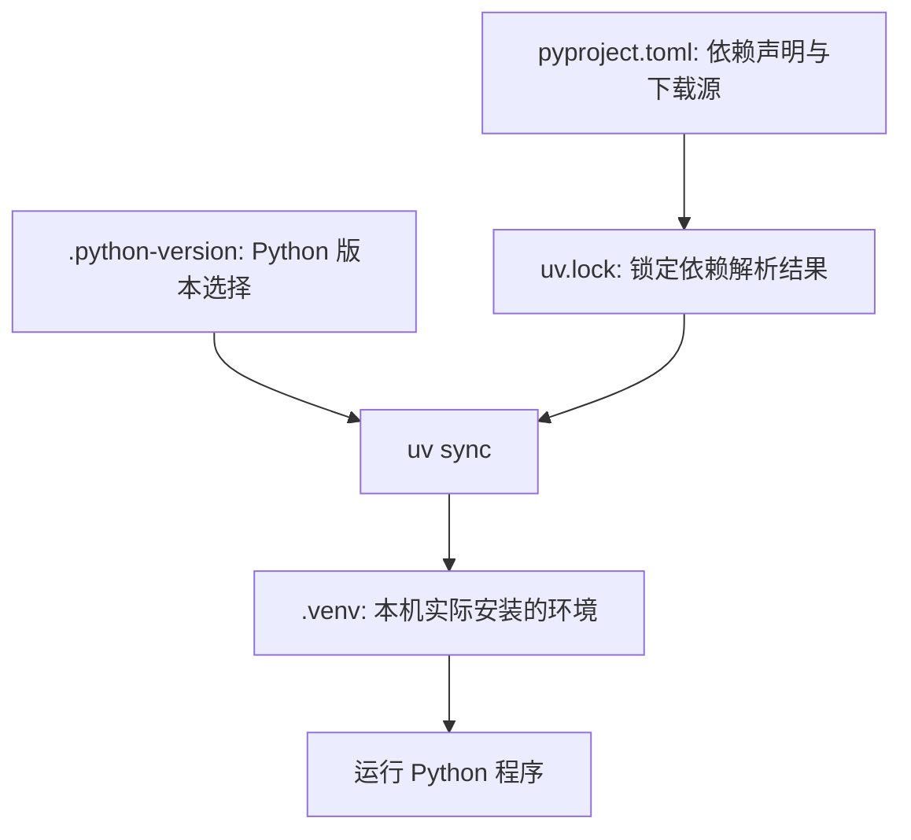

| 文件 | 作用 | 是否提交 Git |
|---|---|---|
| `.python-version` | 默认 Python 版本选择 | 是 |
| `pyproject.toml` | 项目元数据、Python 版本约束、依赖及来源 | 是 |
| `uv.lock` | 精确依赖解析结果，包括传递依赖及平台标记 | 是 |
| `.venv/` | 本机安装的解释器和软件包 | 否 |

例如，`pyproject.toml` 中的 `numpy>=2.0` 是版本约束，`uv.lock` 则记录具体解析结果。锁文件有助于复现环境，但不能替代系统驱动、硬件及平台兼容性检查。

### 2.2 uv 常用命令

| 命令 | 作用 |
|---|---|
| `uv python install 3.12` | 安装 Python |
| `uv python pin 3.12` | 固定项目默认 Python 版本 |
| `uv venv --python 3.12` | 创建虚拟环境 |
| `uv add numpy` | 声明项目依赖并默认同步 |
| `uv add --dev pytest` | 添加开发依赖 |
| `uv remove numpy` | 移除项目依赖 |
| `uv lock` | 更新锁文件，不同步环境 |
| `uv sync` | 按项目配置和锁文件同步环境 |
| `uv sync --locked` | 要求锁文件有效，否则报错 |
| `uv sync --dry-run` | 预览同步计划 |
| `uv run python script.py` | 自动检查并同步环境后运行 |
| `uv run --no-sync python script.py` | 不自动同步环境，直接运行 |
| `uv pip install PACKAGE` | 直接安装到目标虚拟环境，不更新项目依赖声明 |
| `uv pip list` / `uv pip check` | 查看已安装依赖 / 检查依赖一致性 |
| `uv tree` | 查看项目依赖树 |

日常推荐使用 `uv run`，无需手动激活；也可以使用传统方式：

```bash
source .venv/bin/activate   # macOS / Linux Bash
python --version
deactivate
```

Windows PowerShell：`.venv\Scripts\Activate.ps1`（远程 SSH 进入 Linux 后仍使用 Linux 命令）。

### 2.3 uv add 与 uv pip install

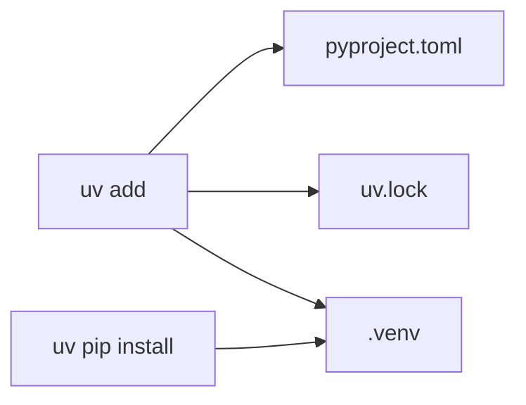

正常项目开发使用 `uv add`。临时实验或分阶段排查依赖问题时可使用 `uv pip install`，但应注意此时实际环境可能与锁文件不一致。不要在尚未记录手动安装版本时直接执行 `uv sync`，它默认会进行精确同步，可能移除额外包或替换版本。

## 3. PyTorch 与 GPU 环境

### 3.1 macOS：CPU 与 MPS

```bash
uv add numpy torch
uv run python -c 'import torch; print(torch.__version__); print(torch.backends.mps.is_available())'
```

Apple Silicon 通常使用 Metal Performance Shaders（MPS）作为 PyTorch GPU 后端，而不是 CUDA。实际支持情况取决于系统、硬件和 PyTorch 版本。

通用设备选择示例：

```python
import torch

if torch.cuda.is_available():
    device = torch.device('cuda')
elif torch.backends.mps.is_available():
    device = torch.device('mps')
else:
    device = torch.device('cpu')

x = torch.randn(1024, 1024, device=device)
y = x @ x
print(y.shape, y.device)
```

### 3.2 Linux NVIDIA：Driver、Runtime、Toolkit

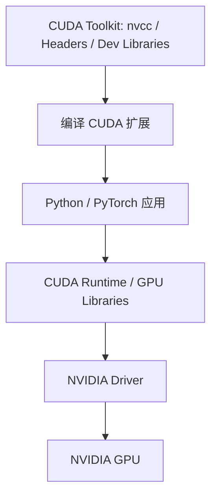

| 层次 | 作用 | 检查方式 |
|---|---|---|
| GPU | 执行并行计算 | `nvidia-smi` |
| Driver | 驱动 GPU，提供驱动 API | `nvidia-smi` |
| Runtime / Libraries | 运行 CUDA 程序、提供数学运算库 | `torch.version.cuda`（PyTorch 构建版本） |
| Toolkit | 编译 CUDA 程序或扩展，包含 `nvcc` 等开发工具 | `nvcc --version` |

**注意：** `nvidia-smi` 显示的 CUDA Version 是驱动支持的 CUDA 版本，不表示相应 Toolkit 已经安装；`torch.version.cuda` 是 PyTorch 构建所用的 CUDA 版本，不是本地 Toolkit 的检测结果。

安装预编译 CUDA 版 PyTorch 通常不需要 `nvcc`。源码编译 CUDA 扩展则通常需要兼容的 Toolkit、宿主编译器等工具链。

### 3.3 Linux CUDA 版 PyTorch 安装示例

下面以 Python 3.12、PyTorch 2.8.0 和 CUDA 12.8 wheel 为例。不是最新版本推荐，也不适用于所有 GPU/操作系统；先确认驱动、GPU 架构和软件包支持情况。

在已有项目的 `pyproject.toml` 中配置（合并到已有表，不要重复创建）：

```toml
[tool.uv.sources]
torch = { index = "pytorch-cu128" }

[[tool.uv.index]]
name = "pytorch-cu128"
url = "https://download.pytorch.org/whl/cu128"
explicit = true
```

```bash
uv add 'torch==2.8.0+cu128' numpy
```

此配置针对支持 CUDA 的 Linux 项目；如果同一个仓库同时支持 Mac，需要进一步设置平台条件和相应来源，不应直接照搬 Linux 专用配置。

临时安装方式（不修改项目声明）：

```bash
uv venv --python 3.12
uv pip install torch==2.8.0 --index-url https://download.pytorch.org/whl/cu128
```

GPU 验证：

```bash
nvidia-smi
uv run --no-sync python - <<'PY'
import torch
print('Torch:', torch.__version__)
print('CUDA build:', torch.version.cuda)
print('CUDA available:', torch.cuda.is_available())
if torch.cuda.is_available():
    print('GPU:', torch.cuda.get_device_name(0))
    print('Compute capability:', torch.cuda.get_device_capability(0))
    x = torch.randn(1024, 1024, device='cuda')
    y = x @ x
    torch.cuda.synchronize()
    print(y.shape, y.device)
PY
```

### 3.4 Wheel、源码编译与 Build Isolation

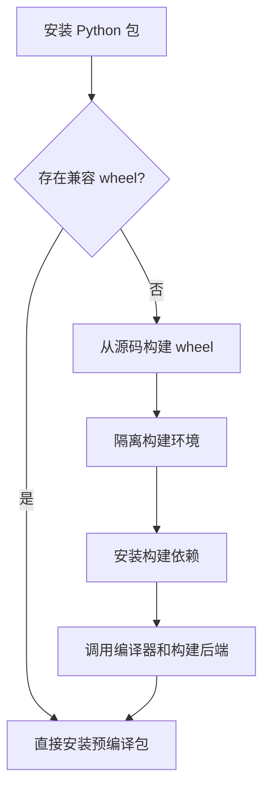

预编译 wheel 需要匹配 Python ABI、操作系统、CPU 架构；对于 PyTorch CUDA 扩展，还可能需要匹配 PyTorch、CUDA 和 C++ ABI。

```bash
uname -m
uv run --no-sync python -c 'import torch; print(torch.__version__, torch.version.cuda, torch._C._GLIBCXX_USE_CXX11_ABI)'
```

Build Isolation 指构建依赖位于临时隔离环境，而不是项目 `.venv`。如果包在构建时依赖某个未声明的库，即使该库已安装在项目环境中，也可能发生 `ModuleNotFoundError`。可以按包的构建要求补充构建依赖，或在确有必要时使用 `--no-build-isolation` 并自行确保完整构建依赖。禁用隔离不是默认推荐方案。

## 4. 可复现环境与跨机器迁移

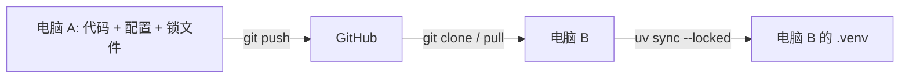

新电脑已有 uv：

```bash
git clone <repository-url>
cd ai-infra-guide
uv sync --locked
uv run python --version
```

已有项目更新：

```bash
git pull --ff-only
uv sync --locked
```

不要跨机器复制 `.venv`，因为解释器路径、平台和二进制依赖可能不同。

如果曾通过 `uv pip install` 手动安装依赖：

```bash
uv pip freeze > requirements-working.txt
uv pip check
```

先检查快照中的本地绝对路径、editable 项目路径和特殊包来源，再决定是否提交。快照不保证所有依赖来源可复现。将验证成功的版本和下载源记录到 `pyproject.toml` 后：

```bash
uv lock
uv sync --locked --dry-run
uv sync --locked
```

执行最后一步前先检查预览。重要环境可先在另一个目录或独立虚拟环境验证重建，避免破坏唯一可工作的环境。

## 5. Git 的四个区域

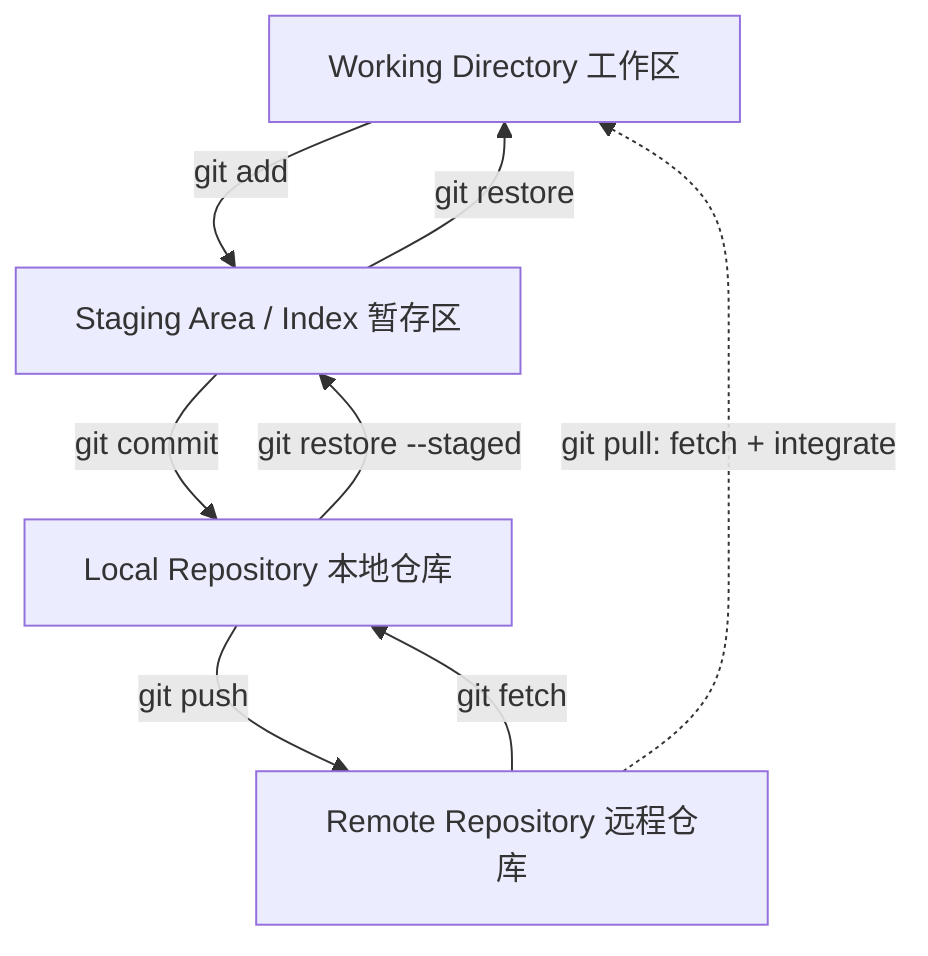

图中逆向 restore 箭头表示以源区域的内容恢复目标区域，不是移动或删除源区域中的数据。

| 区域 | 本质 | 记忆方式 |
|---|---|---|
| Working Directory | 正在编辑的文件 | 我正在写什么？ |
| Staging Area / Index | 下一次 commit 的预备快照 | 我准备提交什么？ |
| Local Repository | 已提交的快照、历史及引用 | 我已保存哪些版本？ |
| Remote Repository | 远端服务器上的提交与分支 | 我已共享哪些版本？ |

前三者都在本地。`git add` 和 `git commit` 不需要网络。

### 5.1 用一个例子理解暂存区

假设 `attention.py` 初始为 V1：

| 操作 | 工作区 | 暂存区 | 本地 HEAD | 远端分支 |
|---|---|---|---|---|
| 初始状态 | V1 | V1 | V1 | V1 |
| 修改代码 | V2 | V1 | V1 | V1 |
| `git add attention.py` | V2 | V2 | V1 | V1 |
| 再次修改 | V3 | V2 | V1 | V1 |
| `git commit` | V3 | V2 | V2 | V1 |
| `git push` | V3 | V2 | V2 | V2 |

这说明 `git add` 记录的是当时文件的内容，而不只是文件名。V3 未被再次暂存，因此不会随本次提交上传。

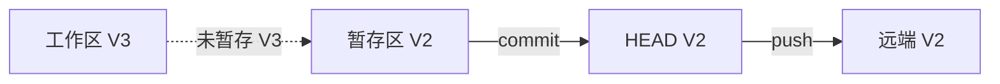

### 5.2 本地仓库内部结构

```text
.git/
├── objects/       # commit、tree、blob 等 Git 对象
├── refs/          # 分支、标签等引用（也可能打包存储）
├── HEAD           # 当前检出的分支或提交
├── index          # 暂存区
├── config         # 仓库配置
└── logs/          # 引用变更记录（reflog）
```

Commit 是项目快照及其元数据，包括父提交引用、作者、提交说明等。分支是指向 commit 的可移动引用，不是项目文件的完整复制品。

## 6. git status 与 git diff

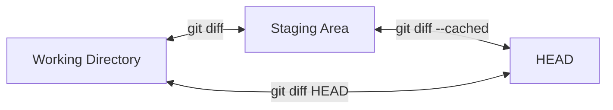

| 命令 | 比较对象 / 功能 |
|---|---|
| `git status` | 概览当前分支与文件状态 |
| `git diff` | 工作区 vs 暂存区 |
| `git diff --stat` | 未暂存修改统计 |
| `git diff --cached` | 暂存区 vs HEAD |
| `git diff --cached --stat` | 已暂存修改统计 |
| `git diff HEAD` | 工作区中的已跟踪内容 vs HEAD |
| `git diff main` | 当前工作区中的已跟踪内容 vs 本地 main |
| `git diff main...HEAD` | 当前提交相对与 main 的共同祖先的改动 |

普通 `git diff` 不显示未跟踪文件的内容，因此要结合 `git status` 检查。

```bash
git add pyproject.toml
git diff --cached --stat
git diff --cached -- pyproject.toml
```

示例统计（非实际项目输出）：

```text
pyproject.toml | 8 +++++---
1 file changed, 5 insertions(+), 3 deletions(-)
```

`+` 表示新增行，`-` 表示删除行。`--stat` 只展示改动规模，真正的代码审查还需要查看完整 diff。

## 7. GitHub 上传与 .gitignore

推荐规则（根据项目实际目录调整）：

```gitignore
# Local environments
.venv/
venv/
# Python caches and builds
__pycache__/
*.py[cod]
*.egg-info/
build/
dist/
.pytest_cache/
.ruff_cache/
.mypy_cache/
.ipynb_checkpoints/
# OS / IDE
.DS_Store
.idea/
# Local secrets and temporary files
.env
.env.*
!.env.example
*.bak
*.log
# Large binary artifacts
*.whl
*.safetensors
*.pt
*.pth
*.ckpt
checkpoints/
outputs/
wandb/
```

不要忽略 `uv.lock`、`pyproject.toml`、`.python-version`、源码、Markdown 和学习图片。若需要忽略大型数据目录，请根据实际结构添加规则，避免误忽略源码或小型测试数据。

如果 `.venv` 已被 Git 跟踪，添加 ignore 规则不会自动取消跟踪：

```bash
git rm -r --cached .venv
git add .gitignore
```

此命令仅在已跟踪 `.venv` 时需要执行；不会删除本地环境。若大文件或秘密已进入历史，单纯取消跟踪不能清除历史中的数据，需要额外处理，泄露的凭据应轮换。

检查规则：

```bash
git check-ignore -v .venv/bin/python
git status --short
git ls-files .venv
```

### 7.1 第一次上传自己的新项目

在 GitHub 创建空仓库（本地已有 README 等文件时避免远端额外初始化）。若 `uv init` 未初始化 Git，再执行 `git init`。

```bash
git status
git add .
git diff --cached --stat
git diff --cached
git commit -m "chore: initialize AI infra guide"
git branch -M main
git remote add origin <your-repository-url>
git push -u origin main
```

`-u` 为本地分支设置上游跟踪关系，之后一般可以直接 `git push` 和 `git pull`。已有 `origin` 时不要重复添加，应先检查 `git remote -v`。

## 8. 分支、HEAD 与远程引用

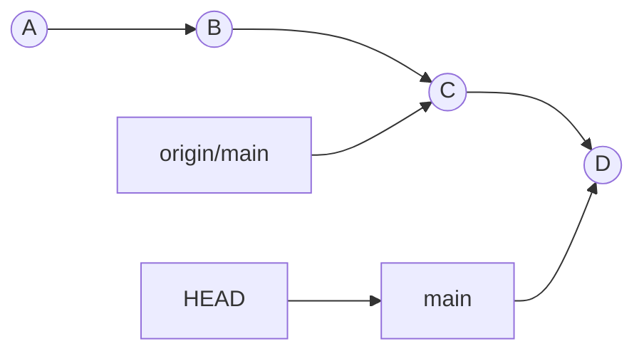

- `HEAD`：当前检出的分支或提交。
- `main`：本地主分支引用。
- `origin`：远程仓库别名。
- `origin/main`：本地保存的远程跟踪引用，不是实时查询 GitHub 的结果。

图中本地 main 领先远端跟踪引用一个提交；成功 push 后对应远端分支及本地跟踪引用通常都会更新。

### 8.1 创建分支和合并

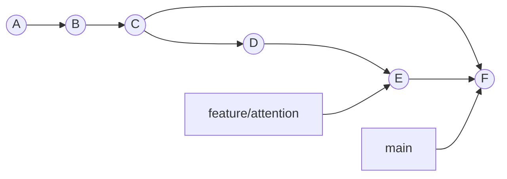

这是有合并提交的示例；如果主线没有分叉，普通 merge 也可能直接 fast-forward，不创建额外合并提交。

```bash
git switch main
git pull --ff-only
git switch -c feature/attention
# 修改和测试代码
git add examples/attention.py
git diff --cached
git commit -m "feat: add attention example"
git push -u origin feature/attention
```

可以在 GitHub 创建 Pull Request 审查并合并，或对个人项目在本地合并：

```bash
git switch main
git merge feature/attention
git push origin main
git branch -d feature/attention
```

`git branch -d` 删除的是分支引用；正常合并后的历史仍然可以通过主线访问。若采用 squash merge，Git 可能无法判断原分支已合并，此时不要盲目强制删除。

推荐命名：`feature/attention`、`docs/cuda-notes`、`fix/device-selection`、`experiment/matmul-benchmark`。

### 8.2 Fork 与 upstream

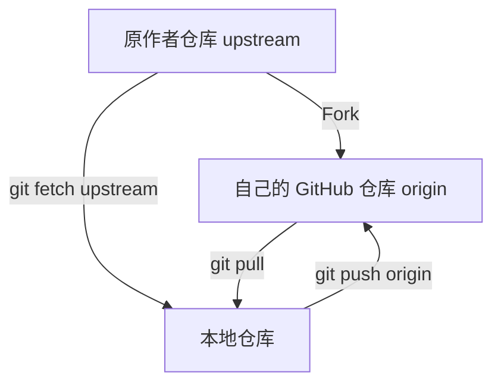

先执行 `git remote -v` 判断当前 `origin` 指向哪里。如果已经克隆自己的 Fork，保留 `origin`，只需添加原作者仓库为 `upstream`。如果克隆的是原作者仓库，且已创建自己的 Fork，可以：

```bash
git remote rename origin upstream
git remote add origin <your-fork-url>
git remote -v
```

获取原作者更新：

```bash
git fetch upstream
git log --oneline --graph --all
```

`fetch` 下载提交并更新远程跟踪引用，不直接修改当前工作区。`pull` 则是 fetch 加上整合步骤（merge、rebase 或 fast-forward，取决于配置和参数）。

## 9. 日常工程开发流程

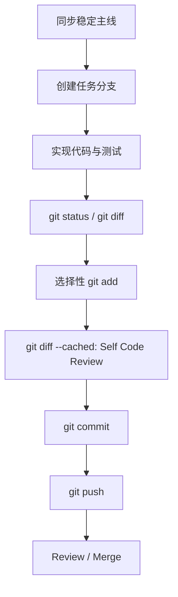

```bash
git switch main
git pull --ff-only
git switch -c feature/kv-cache
# 编写代码后
uv run pytest
git status
git diff
git add <changed-files>
git diff --cached --stat
git diff --cached
git commit -m "feat: implement KV cache"
git push -u origin feature/kv-cache
```

Commit message 建议采用简化 Conventional Commits：

| 前缀 | 用途 | 示例 |
|---|---|---|
| `feat:` | 新功能 | `feat: implement BPE tokenizer` |
| `fix:` | 修复 | `fix: handle unavailable GPU` |
| `docs:` | 文档 | `docs: explain tensor memory layout` |
| `refactor:` | 重构 | `refactor: simplify device selection` |
| `test:` | 测试 | `test: add attention shape tests` |
| `chore:` | 工程维护 | `chore: update dependencies` |

Atomic Commit：一次提交围绕一个独立、明确的任务。使用 AI Agent 修改代码时，更要先审查 diff，避免无关改动、凭据或大型二进制进入提交。

## 10. Git 恢复命令与安全边界

| 命令 | 作用 |
|---|---|
| `git restore file.py` | 用暂存区内容恢复工作区，丢弃该文件未暂存改动 |
| `git restore --staged file.py` | 用 HEAD 内容恢复暂存区，保留工作区改动 |
| `git add -p` | 选择性暂存代码片段 |
| `git log --oneline --graph --all` | 查看提交及分支图 |
| `git branch -avv` | 查看本地及远程跟踪分支 |
| `git revert <commit>` | 通过新提交撤销已有提交 |

初学阶段避免盲目使用 `git reset --hard`、`git clean -fd` 或强制 push。这些操作可能丢失工作区内容或改写共享历史。

## 11. 最终检查清单

- [ ] Python 版本符合项目要求。
- [ ] PyTorch 能实际运行目标设备的矩阵运算。
- [ ] `uv pip check` 无依赖冲突。
- [ ] 项目依赖和特殊下载源已经写入配置，锁文件有效。
- [ ] `.venv`、权重、秘密文件没有被 Git 跟踪。
- [ ] `git diff --cached` 已检查本次提交内容。
- [ ] `origin` 指向自己有权限写入的仓库。
- [ ] 在兼容的另一套环境中验证 `uv sync --locked` 可重建。

## 12. 官方参考资料

- [uv 项目管理](https://docs.astral.sh/uv/guides/projects/)
- [uv 项目依赖管理](https://docs.astral.sh/uv/concepts/projects/dependencies/)
- [PyTorch 安装指南](https://pytorch.org/get-started/locally/)
- [PyTorch MPS 后端](https://docs.pytorch.org/docs/stable/notes/mps.html)
- [Pro Git](https://git-scm.com/book/en/v2)
- [Git diff 文档](https://git-scm.com/docs/git-diff)
- [GitHub Fork 工作流](https://docs.github.com/en/get-started/quickstart/fork-a-repo)

---

**核心结论：** Git 保存代码和可重建环境的描述，而不是实际虚拟环境。uv 负责将描述转换为本机环境。分支组织开发任务，暂存区控制提交范围，diff 保证提交前可以审查改动。

> 图表采用 Mermaid 源码，可在支持 Mermaid 的 GitHub Markdown 或编辑器预览中渲染；普通文本编辑器会显示图表源码。本文为通用学习笔记，命令示例未在你的服务器上重新执行。
